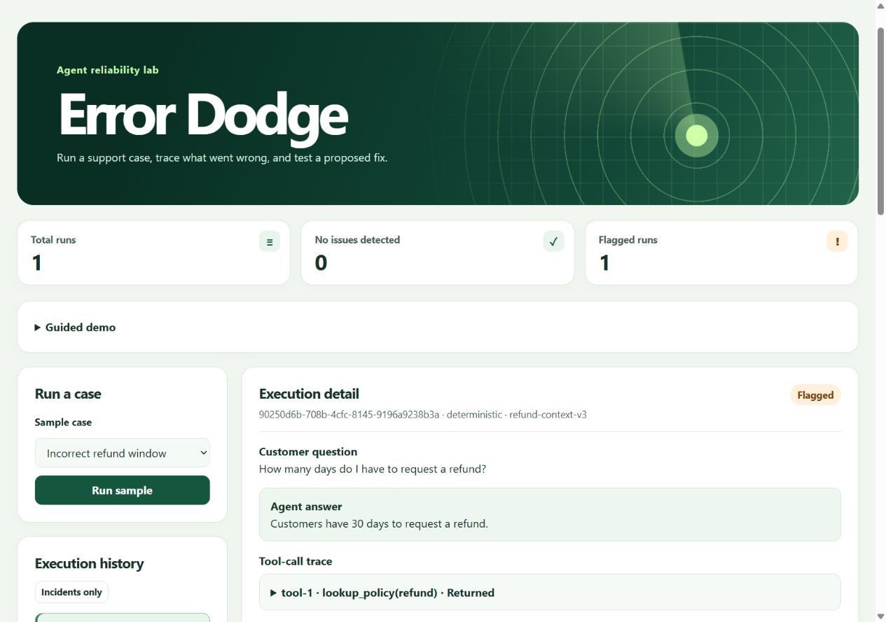
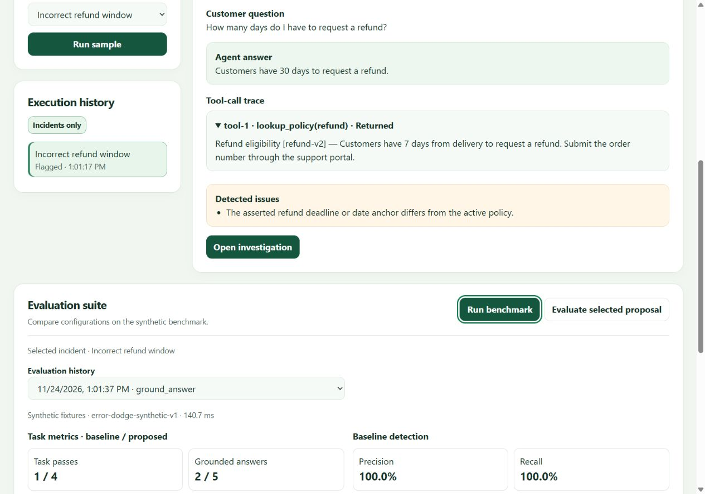
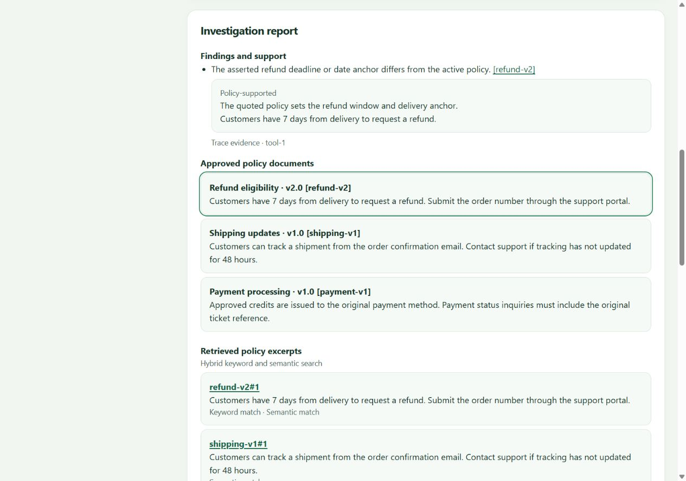
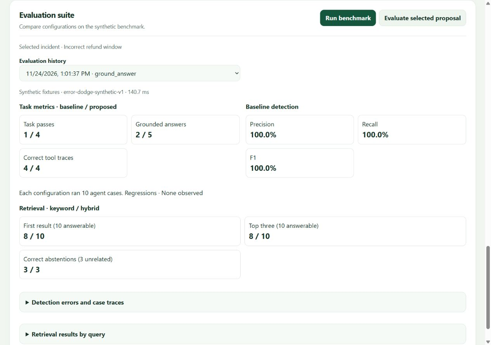
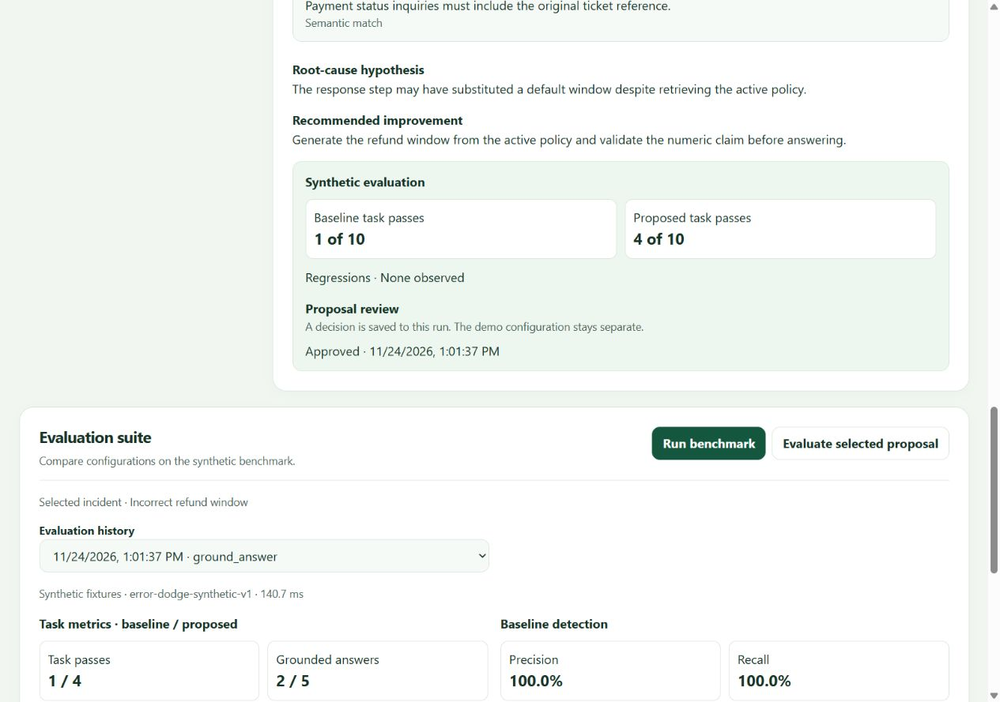

# Error Dodge

**Multi-Agent AI Reliability & Evaluation Platform**

Error Dodge runs a synthetic customer-support agent, captures the tool trace, investigates policy failures, and compares proposed fixes before a reviewer records a decision. Its main demo starts with an agent that says refunds are available for 30 days even though it retrieved a seven-day policy.

## Architecture and technologies

React and Tailwind present the monitoring and review UI. FastAPI and Pydantic validate requests and enforce staging roles. LangGraph orchestrates monitoring, investigation, improvement, evaluation, and review. BM25, Sentence Transformers, and Chroma provide keyword and semantic retrieval over the approved policy corpus. PostgreSQL stores graph checkpoints and benchmarks, with SQLite available for the local demo. LangChain integrates the optional Gemini adapter. [Architecture diagram](docs/portfolio-architecture.md)

## Start the local demo

Use Python 3.14 and Node.js 24. From the project root, run these in two PowerShell terminals.

**Backend**

~~~powershell
py -3.14 -m venv .venv
.\.venv\Scripts\python.exe -m pip install -r requirements.txt
.\.venv\Scripts\python.exe -m uvicorn app.main:app --app-dir backend --host 127.0.0.1 --port 8000
~~~

**Frontend**

~~~powershell
cd frontend
npm ci
npm run dev -- --host 127.0.0.1 --port 5173 --strictPort
~~~

Open [the dashboard](http://127.0.0.1:5173/) and expand **Guided demo**. The API documentation is at [port 8000](http://127.0.0.1:8000/docs). The local setup uses SQLite, keyword search, and the original Phase 4 detector. To demonstrate verified finding support, set `$env:ERROR_DODGE_DETECTOR = 'refund-context-v3'` in the backend terminal before starting Uvicorn. Contextual V4 is an opt-in experiment. The guarded-v2 executor and detector remain in the validation harness.

## Enable local hybrid retrieval

Download the same pinned model revision used for validation. From the project root:

~~~powershell
$model = Join-Path (Get-Location) '.data/models/all-MiniLM-L6-v2'
.\.venv\Scripts\hf.exe download sentence-transformers/all-MiniLM-L6-v2 --revision 1110a243fdf4706b3f48f1d95db1a4f5529b4d41 --include '*.json' '*.txt' 'model.safetensors' --local-dir $model
$env:ERROR_DODGE_EMBEDDING_PATH = $model
.\.venv\Scripts\python.exe -m uvicorn app.main:app --app-dir backend --host 127.0.0.1 --port 8000
~~~

Chroma persists the locally generated embeddings, and the backend combines cosine similarity with BM25. The optional Gemini adapter requires a server-side `GEMINI_API_KEY` and an explicitly configured `GEMINI_MODEL`. The portfolio demo uses synthetic data and makes no paid provider calls.

## What to show

- **Monitoring and incidents.** Run a case and inspect the response, policy lookup, and flagged findings. Filter the execution history to incidents.
- **Investigation and approval.** Inspect the exact seven-day citation, the related source excerpts, and the root-cause hypothesis. A reviewer can persist a decision; the demo configuration is never automatically changed.
- **Evaluations.** Run benchmarks, inspect per-case tool traces and retrieval rows, and reopen saved results. Synthetic metrics describe controlled tests and cannot establish live-model generalization.

## Evaluation methodology

The dashboard replays ten labeled synthetic agent cases under baseline and proposed configurations. The grounding proposal improved task passes from 1/10 to 4/10. A separate retrieval benchmark scored the expected first result on ten answerable questions and abstention on three unrelated ones. Keyword retrieval ranked the correct result first on 8/10 questions and hybrid retrieval did so on 10/10. Both abstained on all three unrelated queries.

The original detector was developed using the ten scripted agent cases. Separate frozen detector comparisons use newly labeled synthetic cases. The benchmark scripts report per-case outcomes and missed labels. These small datasets cover a narrow policy domain and do not predict production performance.

## Test and reproduce

From the project root:

~~~powershell
cd backend
..\.venv\Scripts\python.exe -B -m pytest -q
cd ../frontend
npm ci
npm test
npm run build
~~~

The full backend suite uses a local model and a migrated disposable PostgreSQL database. Without those optional settings, integration tests skip explicitly. Set `ERROR_DODGE_EMBEDDING_PATH` for embedding checks and `ERROR_DODGE_TEST_POSTGRES_URL` for PostgreSQL checks. See the [release report](docs/final-report.md) for the exact verification commands and outcomes.

To reproduce the detector metrics, run the scripts below from the backend directory. The first command requires the local model. The outputs include fixture and detector hashes, and the contextual runner checks them before running.

~~~powershell
$env:PYTHONPATH = (Get-Location).Path
..\.venv\Scripts\python.exe -B tests/validate_contextual.py .\contextual-results.json
..\.venv\Scripts\python.exe -B tests/compare_billing_anchors.py
..\.venv\Scripts\python.exe -B tests/compare_billing_anchors.py --post-fix
~~~

## Project documentation

| Guide | Contents |
|---|---|
| [Architecture](docs/portfolio-architecture.md) | Mermaid diagram, graph flow, retrieval and storage |
| [Interview walkthrough](docs/portfolio-walkthrough.md) | Four-minute demo and discussion questions |
| [Private deployment](docs/deployment.md) | Docker, mounted secrets, loopback, and SSH |
| [Release report](docs/final-report.md) | Measured results, regressions, test coverage and open readiness work |
| [Resume bullets](docs/resume.md) | Three statements based on verified results |
| [Publish to GitHub](docs/publishing.md) | Commit, push, and verify the public repository |
| [Frozen V3 evaluation](docs/contextual-validation.md) | Historical comparison, raw measurement schema and limitations |

## Known limitations

The application and portfolio run are locally verified. Docker execution, external deployment, authenticated live Gemini, production identity, and multi-tenant isolation remain open.
