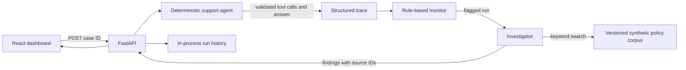
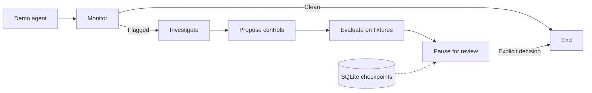

# Error Dodge architecture

## Phase 1 baseline

The demo agent uses an allowlisted read-only lookup and controlled fault modes. The monitor compares the emitted answer and tool trace against available evidence and task signals. The investigator independently retrieves approved documents, retains trace references, and marks uncertain explanations as hypotheses. The original Phase 1 UI counted runs in the current server process. Phase 2 replaces that storage with SQLite checkpoints.

- `backend/app/schema.py` defines API and trace contracts.
- `backend/app/data/` contains synthetic policy documents and labeled scenarios. Labels are test oracles.
- `backend/app/workflow.py` loads the corpus, executes the sample agent, detects issues, and produces cited findings.
- `backend/app/main.py` exposes runs, investigations, and reviews and owns the SQLite connection lifecycle.
- `backend/tests/test_mvp.py` exercises the workflow through the API.
- `frontend/src/` contains the responsive React dashboard and styles.

## Phase 2 LangGraph orchestration

Each node returns updates to shared state. The run UUID is the checkpoint thread ID. The API reads run details, citations, proposals, and results from that thread. The interrupt holds the workflow after evaluation and a review resumes it through the same ID. SQLite provides run-scoped memory across local restarts. Multi-worker review coordination and authenticated audit identity are planned for production.

The evaluation replays the same fixtures for baseline and proposed controls. The task rubric checks the refund window and the relevant lookup trace. A transient timeout proposal allows one additional lookup, stores both attempts, and contributes results only to the synthetic evaluation. A recursion limit guards graph execution. Sandbox comparisons have no deployment effects.

The optional Gemini adapter checks the configured model with Google before requesting a native tool call and a structured response. It permits only read-only policy lookup. Live runs reuse the monitor and investigation. Their proposal evaluations still use the labeled synthetic fixtures. [LangGraph interrupts](https://docs.langchain.com/oss/python/langgraph/interrupts)

## Phased checklist

1. **MVP** — Build the deterministic support agent, policy corpus, trace, rule-based detection, cited reports, API, dashboard, and automated acceptance checks. Use Python, FastAPI, Pydantic, Uvicorn, pytest, HTTPX, React, Vite, and Tailwind CSS.
2. **Orchestration** — Implemented shared state, four specialist nodes, bounded retry for the timeout candidate, checkpoint-based history, and human review. The optional LangChain Gemini adapter requires a configured model and validates its availability at runtime. Authenticated live verification remains pending.
3. **Retrieval and memory** — Implemented versioned policy chunks, BM25 and Chroma semantic retrieval, reciprocal rank fusion, and bounded related-run context. A separate reranker is deferred until a broader retrieval evaluation can justify it.
4. **Evaluation** — Implemented versioned agent and retrieval fixtures, task and grounding rubrics, incident-level precision and recall, tool correctness, and persistent baseline-versus-proposed results. Local traces capture per-case answers, tool calls, detected codes, timings, and dataset provenance.
5. **Production** — Add PostgreSQL and SQLAlchemy migrations for runs, incidents, reports, evaluation results, approvals, and audit events. Use LangGraph interrupts for explicit approval and resume only via an authenticated action. Add authorization, Docker, deployment configuration, and monitoring.
6. **Portfolio** — Publish source with a demo walkthrough, verified test report, known limitations, interview notes, and resume bullets grounded in implemented functionality.

Future data flow extends the API with SQLAlchemy-backed records in PostgreSQL, while ChromaDB holds the retrieval index. Graph checkpoints hold workflow progress, and approval decisions are audited before the graph resumes any change.

## Validation at each phase

Run the existing regression suite and the new phase's acceptance tests. Build the frontend and test the affected dashboard flow against the running API. For interface changes, check desktop and narrow layouts, keyboard focus, and required assets. Record commands, observed outcomes, and any checks blocked by missing credentials or services before moving on.

## Phase 3 retrieval boundary

The investigation node asks PolicyRetriever for up to three ranked excerpts. It resolves their document IDs using the read-only policy corpus. Verified findings retain their authoritative policy references even if ranking excludes a cited document. The Chroma collection name binds the corpus and model fingerprint to the index. Older investigations retain the evidence captured when they ran.

The graph checkpoints up to three related run IDs per new execution. Related runs appear as links in an investigation. Their generated content is excluded from retrieval and from the Gemini prompt. The sample tool still reads one validated policy topic independently of the investigator.

## Phase 4 evaluation flow

The dashboard submits either the standard grounding proposal or a selected incident's controls. The API runs the same ten agent fixtures with each configuration and evaluates the active retriever alongside keyword-only search on thirteen labeled queries. It stores the completed benchmark atomically in a sibling SQLite file. Evaluation runs use an isolated harness and preserve the approval and execution history.

The baseline detection score treats each fixture as flagged or clean. Per-case code differences capture classification errors separately. The grounded answer rubric requires the correct refund window, active-policy evidence, and no unconditional refund promise. Abstentions count as incomplete answers. Retrieval counts rank-1 and rank-3 hits for answerable questions, and no-result responses for unrelated questions.
