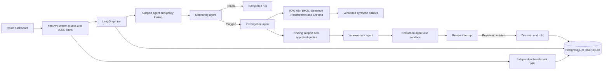

# Error Dodge architecture

FastAPI checks the role before dispatching protected API requests. PostgreSQL holds graph checkpoints and benchmark records when a database is configured. A transaction-scoped advisory lock serializes review attempts for the same run across PostgreSQL-backed API instances. The local SQLite demo uses an in-process review lock. Chroma stores an index of approved policy chunks, and the Sentence Transformers model runs locally when configured. The original trace and the investigator's retrieval remain distinct, so a retrieved policy never implies the agent used it.

Phase 4 remains the default detector. Contextual V3 and V4 are selectable and independently reproducible. The optional Gemini adapter is credential-gated. The portfolio walkthrough uses deterministic fixtures and local embeddings so it runs without a paid model.
